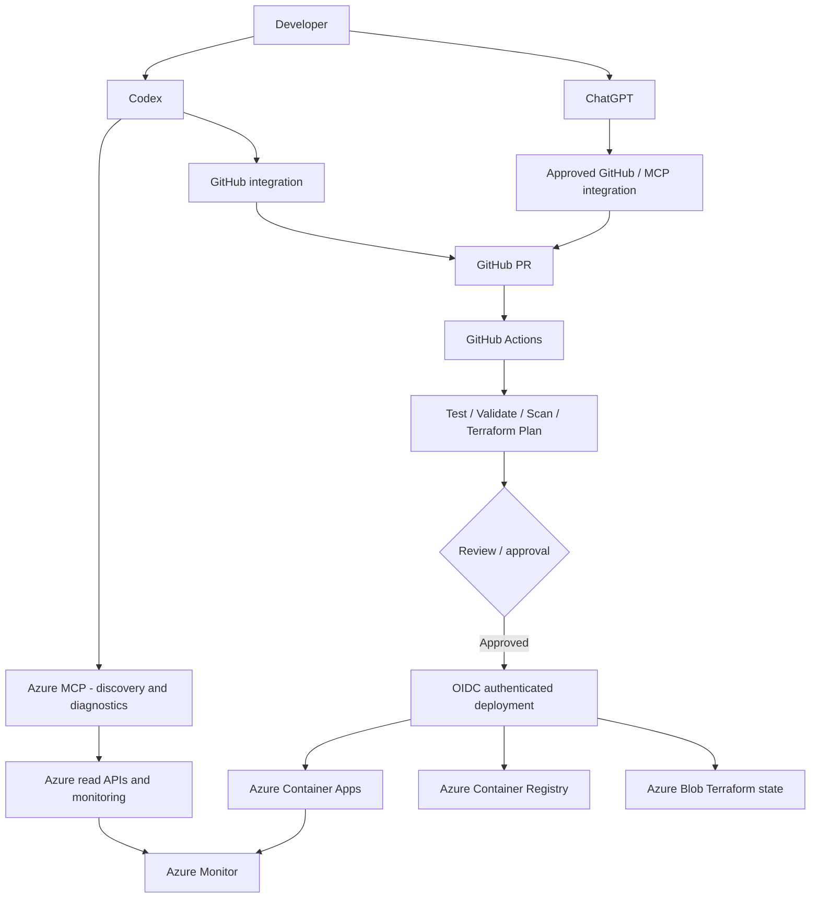

# Technical Architecture

## Architecture decisions

| Area | Choice |
| --- | --- |
| Conversational UI | ChatGPT |
| Coding agent | Codex |
| Integration | Model Context Protocol (MCP) |
| Azure discovery / diagnostics | Official Azure MCP Server |
| GitHub interaction | GitHub MCP Server or available GitHub connector |
| Infrastructure as Code | Terraform |
| CI/CD | GitHub Actions |
| Application runtime | Azure Container Apps |
| Container registry | Azure Container Registry |
| Secrets | Azure Key Vault |
| Identity | Entra ID and GitHub OIDC federation |
| Observability | Azure Monitor, Log Analytics, Application Insights |
| Terraform state | Azure Blob Storage |

## Logical topology

## Control plane

ChatGPT captures intent, assists with planning and summarizes results. Codex edits application code, tests, Dockerfiles, Terraform and GitHub workflows. MCP offers bounded tools for Azure discovery and GitHub operations. Azure MCP is read-only by default.

**Integration caveat:** A local Azure MCP server connected to Codex is not automatically available in ChatGPT. Direct ChatGPT-to-remote-MCP integration requires separately supported connector transport, authentication and tool permissions. The MVP does not depend on it.

## Delivery plane

GitHub is the source of truth. Pull requests trigger unprivileged validation; reviewed changes are deployed through protected GitHub Actions jobs. Deploy identities are distinct from agent identities. Plans and artifacts are associated with the exact commit and environment.

## Runtime plane

Azure Container Apps runs the sample service. ACR stores scanned container images. A managed identity enables image pulls and access to explicitly authorized Key Vault secrets. Azure Monitor provides diagnostics. Azure Blob Storage hosts remote Terraform state.

## Boundaries and principles

1. Agents cannot bypass reviews or execute unrestricted production writes.
2. No persistent Azure secrets in chat or repository.
3. Use scoped OIDC identities and least-privilege RBAC.
4. No privileged deployment tokens in untrusted PR workflows.
5. Terraform apply uses the approved plan for the same commit, state and environment; otherwise re-plan and reapprove.
6. Application deployments use immutable image digests.
7. Log requests, commits, approvals, workflow runs and Azure deployment outcomes.
8. Treat MCP responses, logs and repository files as untrusted data.

## Future deployment MCP facade

A later service can expose narrow operations: `listApplications`, `getDeploymentStatus`, `requestDeployment`, `getDeploymentLogs`. `requestDeployment` creates a PR or controlled deployment request; it must not expose unrestricted Azure management calls. The facade needs authentication, authorization, audit logs, tool allowlists and rate limits.
